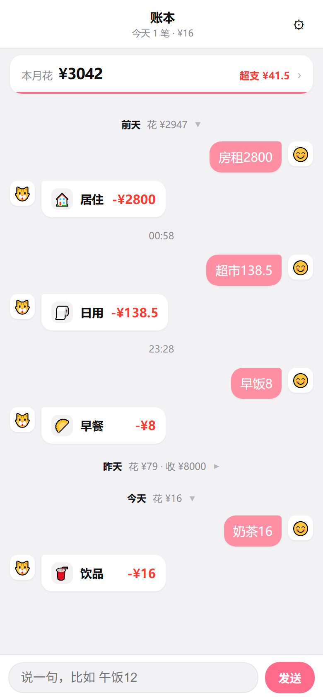
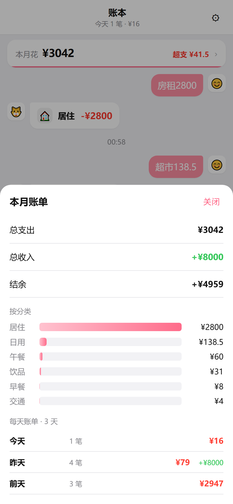

# 聊记 · 发条消息就记好

一个**纯免费、零服务器、零审核**的聊天式记账 App。做成能装到 iPhone 主屏幕的 PWA，点开就是微信聊天界面，发一句「午饭12」就记好了。

模仿对象：那条微信视频里的记账 App（聊天流记账 + 虚拟角色搭话 + 付费墙）。本项目的取舍是**砍掉付费墙和账号体系**，只保留最爽的那部分。

---

## 一、先看它能干什么

| 功能 | 说明 |
|---|---|
| 一句话记账 | 输入「午饭12」「奶茶十五」「昨天打车38」「早饭八块五」，自动认金额 + 认分类 |
| 一句话多笔 | 「午饭12，奶茶15，地铁4」一次落三条账 |
| 聊天流 UI | 你的话是右边的粉色气泡，账目是左边角色发来的卡片，气泡点开可「修改分类 / 改金额 / 删除」 |
| 按天分组 | 每条日期条一个块：「今天 花 ¥67」「昨天 花 ¥121 · 收 ¥8000」；点日期条可折叠整天 |
| 角色台词 | 默认沉默，只出账单卡片。仅三种情况说一句：分类没认出来、本月第一次超支、每类满第 10 笔。有「对方正在输入…」 |
| 预算条 | 一行：本月花多少 / 剩多少 · 日均多少；超支变红。点它打开统计 |
| 统计 | 总支出 / 总收入 / 结余 + 按分类排行 + **每天账单**（倒序，点某天展开当天每一笔） |
| 离线可用 | Service Worker 缓存，断网也能记 |
| 数据自持 | 只写 localStorage，可导出/导入 JSON、导出 CSV，无账号、无上传 |
| 防丢 | 每天首次打开自动留一份快照（`chatledger.v2.bakday`）；超 15 笔未导出、或距上次导出超 30 天，预算条右侧提示「该备份了」 |
| 撤销 | 删除后 4 秒内点提示条可撤回 |
| 快捷入口 | `?add=午饭12` 直接入账，可接 iOS 快捷指令 / 分享菜单 |
| 可选接大模型 | 设置 → 进阶里填任意 OpenAI 兼容接口（DeepSeek 等），角色台词换成本人化生成；不填就是纯本地零成本 |





---

## 二、文件清单

```
chat-ledger/
├── index.html            单文件应用（HTML+CSS+JS 全在里面，无构建、无依赖）
├── manifest.json         PWA 清单（名字/图标/独立窗口）
├── sw.js                 Service Worker，离线缓存
├── icon-1024.png         图标源
├── icon-512.png
├── icon-192.png
├── apple-touch-icon.png  iOS 主屏幕图标（180×180）
├── README.md             本文件
├── 方案B-微信小程序与真人对话.md
├── shot-*.png            截图（390×844 实机比例）
├── serve.cmd             双击 = 局域网起服务，iPhone 同 WiFi 直接试玩
├── push.cmd / push.ps1   双击 = 一键建仓库 + 推送 + 开 GitHub Pages（要 gh 已登录）
├── push-git.cmd          双击 = 纯 git 推送，只问你要一个 PAT，不装任何东西
├── proxy-on.cmd          双击 = 只给本仓库挂 127.0.0.1:7890 代理
├── .github/workflows/pages.yml   GitHub Actions 自动发布
├── .nojekyll             告诉 Pages 别跑 Jekyll 处理
├── LICENSE               MIT
└── .gitignore / .gitattributes
```

> 仓库已经初始化好，首次提交也做完了（`git log` 能看到）。剩下只差 GitHub 那边的授权。

---

## 三、装到 iPhone 上

### 方案 0：现在就能用（不用 GitHub）

双击本目录里的 **`serve.cmd`**，黑窗口会打印出形如 `http://192.168.1.20:8080` 的地址（可能有好几个，选以 192.168 或 10 开头的那个）。

iPhone 连同一个 WiFi，用 **Safari** 打开这个地址，就能用。

> 缺点：不是 https，iOS 不会给「添加到主屏幕」的完整体验（图标能用、全屏能用，但 Service Worker 不注册、离线不生效）。用来验收 UI 足够。
> 关掉黑窗口＝停止服务。

### 方案 A：GitHub Pages —— 推荐，一次性，之后永久在线

仓库已经初始化好了（`git init` 过了，首次提交也有了），只差最后「建仓库 + 推送 + 开 Pages」这三步，全在一个脚本里：

1. 装 GitHub CLI（若还没装）：`winget install GitHub.cli`
2. 登录：`gh auth login -h github.com -p https -w` —— 在浏览器里过完 2FA，终端就拿到凭据了。
3. 双击 **`push.cmd`**（或 `powershell -ExecutionPolicy Bypass -File .\push.ps1`）。

脚本会依次做：检查登录 → 创建 `<用户名>/chat-ledger` 公开仓库 → 推送 `main` → 打开 Pages（Actions 模式）→ 打印最终地址。

> **2FA 没弄好也能先跳过**：脚本会停在「未登录」那一步，什么都不改。等 2FA 弄完再双击一次即可，之前的工作不会浪费。
> 脚本里写死了代理 `http://127.0.0.1:7890`（本机 github.com 直连超时，必须走代理）。没有代理就把 `$PROXY` 改成空字符串。
>
> **不想装 gh？** 用 `push-git.cmd`：先在网页上建好空仓库，再生成一个勾了 `repo` + `workflow` 的 PAT，双击脚本粘进去就行。
>
> **2FA 怎么弄**：这台机器的情况是「短信不可用（GitHub 的短信支持国家里没有中国）、Passkey 不可用（无 TPM / 无 Windows Hello）」，只能走 TOTP。离线验证码器和完整步骤在隔壁目录 `F:\pcl\2fa-tool\`（那里有 `totp.html` 双击即用 + `README.md` 手册）。

跑完后等 1～2 分钟，Actions 变绿，访问 `https://<用户名>.github.io/chat-ledger/`。

4. **iPhone 必须用 Safari** 打开这个地址 → 底部「分享」→「添加到主屏幕」→ 命名「聊记」→ 添加。
5. 从主屏幕图标点开，就是全屏无地址栏的 App，断网可用。

> 只有 Safari 的「添加到主屏幕」会生成独立窗口 + 使用 `manifest.json` 的名字和图标；微信内置浏览器、Chrome iOS、Edge iOS 都不行。

### 方案 B：手动拖文件（不想装 gh 也行）

1. 浏览器打开 GitHub（挂代理），新建仓库 `chat-ledger`，**Public**。
2. 把本目录所有文件（含 `.github/`、`.nojekyll`；`.git/` 不用管）拖进网页上传。
3. Settings → Pages → Source 选 **GitHub Actions**（仓库里已带 `.github/workflows/pages.yml`，推上去就会自动构建）。
   - 想用分支模式也行：Source 选 `Deploy from a branch` → `main` / `(root)`。
4. 剩下的同方案 A 第 4、5 步。

### 方案 C：Cloudflare Pages —— 同样免费，可绑自己域名

1. 登录 Cloudflare → Workers & Pages → Create → Pages → Upload assets。
2. 把整个目录拖进去 → Deploy。得到 `https://xxx.pages.dev`。
3. 剩下同方案 A 第 4、5 步。

### 网络：这台机器上实测的结果

| 站点 | 直连 | 走 `127.0.0.1:7890` |
|---|---|---|
| github.com | ❌ 超时 | ✅ 200 |
| api.github.com | ✅ 200 | ✅ |
| vercel.com / app.netlify.com | ❌ 超时 | ✅ |
| dash.cloudflare.com | ❌ 超时 | ⚠️ 403（CF 挡了代理出口 IP，换节点再试） |
| gitee.com | ✅ 200 | ✅ |

结论：**做 GitHub 相关的事必须挂代理**，`push.ps1` 里已经写死了。REST API 直连能用，所以即便网页打不开，也能用 `curl` + Personal Access Token 建仓库（见下）。

### 网页版 GitHub 打不开时的备用通道

**用 API 建仓库（不需要打开网页）**

1. 打开 `https://github.com/settings/tokens`（打不开就先挂代理）→ Generate new token (classic) → 勾 `repo` + `workflow` → 生成。
2. 在本目录执行：

   ```bash
   curl -x http://127.0.0.1:7890 -H "Authorization: Bearer ghp_你的token" \
        -H "Accept: application/vnd.github+json" \
        -d '{"name":"chat-ledger","private":false}' \
        https://api.github.com/user/repos
   ```

3. 然后 `git push -u origin main`（token 当密码：用户名填 `rfioly`，密码粘贴 token）。
4. 开 Pages 也是一条 API：

   ```bash
   curl -x http://127.0.0.1:7890 -X POST -H "Authorization: Bearer ghp_你的token" \
        -H "Accept: application/vnd.github+json" \
        -d '{"build_type":"workflow"}' \
        https://api.github.com/repos/rfioly/chat-ledger/pages
   ```

**Gitee 镜像（国内直连，不挂代理）**

`gitee.com` 直连 ✅ 200，当**代码备份**很稳：建仓库 → `git remote add gitee https://gitee.com/<用户名>/chat-ledger.git` → `git push gitee main`。
当**发布渠道**就别指望了：Gitee Pages 免费版要实名认证 + 仓库人工审核，且每次更新得手动点「更新部署」，历史上还多次停服调整。**发布认准 GitHub Pages。**

---

## 四、五条路线的筛选结论（为什么最后是这个）

评分维度对应你提的两个硬约束：**纯免费**、**最快捷**。

| 路线 | 直接成本 | 上手速度 | 苹果端体验 | 上架/合规 | 结论 |
|---|---|---|---|---|---|
| **PWA（本项目）** | **¥0** | **当天可用** | 主屏幕全屏，够用 | **无需审核/备案** | ✅ 主推 |
| 微信小程序 | ¥0（个人主体可注册） | 1～3 天 | 免安装，转发方便 | 需认证+**ICP 备案**；iOS 端**禁止虚拟支付** | ⚠️ 只做引流壳 |
| iOS 原生（SwiftUI） | ¥688/年开发者账号 | 2～4 周 | 最好 | App Store 审核 + 备案 | ❌ 违背「免费·快」 |
| Flutter / RN | ¥0～688 | 1～2 周 | 好 | 同上，仍需签名分发 | ❌ 慢 |
| iOS 快捷指令 | ¥0 | 半天 | 只能记账，无界面 | 无 | ➕ 当输入外挂 |

**被砍掉的东西及原因：**

- **VIP 付费墙 / 内购**：视频里 ¥38 月 / ¥88 年 / ¥198 买断。做订阅就要开发者账号（¥688/年）+ 审核 + 订阅合规六要素 + 退款客服，和「纯免费」直接冲突。个人自用也没有付费对象。
- **云端大模型兜底**：一句一回调用要花钱，且要维护 key。改成「本地规则解析为主 + 可选自带 key」——不填就 ¥0，想更强自己填。
- **账号 / 云同步**：要服务器要备案。改成导出/导入 JSON，换机手动搬。
- **微信小程序收钱**：iOS 上小程序内虚拟支付被明令禁止，收费路线在小程序里根本走不通，只能导流到 H5。

---

## 五、想再往前走的话（按性价比排序）

1. **iOS 快捷指令一键记账**（半天，¥0）：快捷指令里「获取剪贴板/听写文本」→「打开 URL」→ `https://你的域名/?add=` + 文本。锁屏小组件点一下就能记。
2. **微信/支付宝账单 CSV 导入**（1 天）：把 `parse()` 换成按列映射，一次补全历史账。
3. **存到 iCloud 文件夹**（1 天）：用 File System Access API 或手动导出到「文件」App，天然跨设备。
4. **换肤 / 多角色**（半天）：视频里那套「换肤库」「虚拟人设」，本质是给 `S.settings` 加主题数组 + 台词池，纯前端。
5. **接大模型**：设置里已留三个字段。注意浏览器直连第三方 API 常被 CORS 拦，稳妥做法是套一层自己的 Cloudflare Worker 代理（免费额度足够个人用），把地址填成代理地址。

---

## 六、给开发者的话

- 无构建、无依赖、无框架。改完直接刷新。
- 数据结构：`localStorage["chatledger.v2"] = { settings:{budget,name,avatar,aiUrl,aiKey,aiModel}, entries:[{id,ts,amount,cat,emoji,income,conf,note}], msgs:[{id,ts,from,type,text|entryId}], seeded, lastOpen, snapDay, lastExport }`。
- 按天分组靠三个纯函数：`dk(ts)` 出 `"Y-M-D"` 当分组键、`dayTotals(list)` 归并成 `{out,inc,n}`、`dayHeadHtml(k,o)` 出日期条；折叠状态在内存对象 `_fold[k]` 里，不落盘（刷新后全展开）。
- 解析入口 `parse(text)`（单句）与 `parseAll(text)`（按 `，。；、\n` 切多句，任一句没金额就跳过）；记账 `addBatch(list, rawText)`；台词入口 `reply(entry)`；渲染 `render()`；统计 `openStats()`。
- 台词走「静默优先」：`reply(entry)` 绝大多数情况返回空字符串，于是 `addEntry` 不出打字动画、不推文本气泡，只落一张账单卡片。只有三种情况返回非空：`conf<0.7`（分类是猜的）、本月首次 `left<0`（用 `S.oversaid` 记录当月只说一次）、同类第 10 笔。要加台词就往 `reply()` 里加 return 分支。
- 加分类只需往 `CATS` 里加 `{k,e,ws:[]}`；`income:true` 表示收入类。
- 改完 `sw.js` 里的 `CACHE = 'chatledger-vN'` 版本号，否则手机上的旧缓存不会更新。

---

## 七、边界

- 数据只在本机浏览器，**清缓存/删 App 就没了**，定期用「导出备份」。
- 没有多设备同步、没有多账本。金额可以改（点账单卡片 → 改金额），但改不了日期。
- 「午饭12和奶茶15」这种用「和」连起来的句子只会记第一笔（`和` 不在分隔符里，刻意保守，避免把描述里的字当新账）。
- 台词数少是刻意的：记账是高频动作，每次都评价会烦。想换真人感就在设置里接自己的模型，本地只保留「非说不可」的三条。
