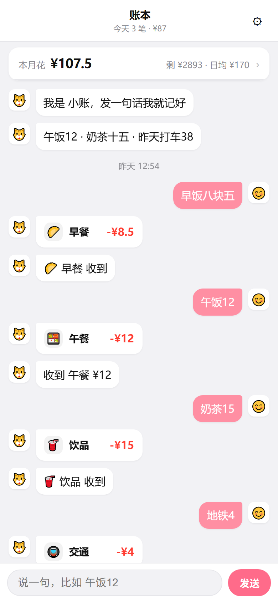
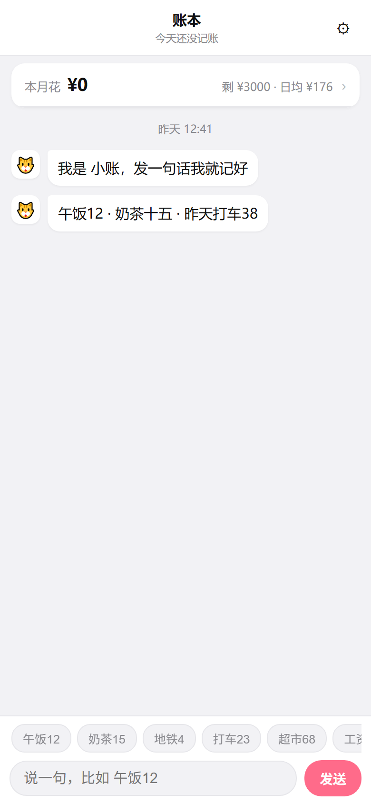

# 聊记 · 发条消息就记好

一个**纯免费、零服务器、零审核**的聊天式记账 App。做成能装到 iPhone 主屏幕的 PWA，点开就是微信聊天界面，发一句「午饭12」就记好了。

模仿对象：那条微信视频里的记账 App（聊天流记账 + 虚拟角色搭话 + 付费墙）。本项目的取舍是**砍掉付费墙和账号体系**，只保留最爽的那部分。

---

## 一、先看它能干什么

| 功能 | 说明 |
|---|---|
| 一句话记账 | 输入「午饭12」「奶茶十五」「昨天打车38」「早饭八块五」，自动认金额 + 认分类 |
| 聊天流 UI | 你的话是右边的粉色气泡，账目是左边角色发来的卡片，气泡点开可「修改分类 / 删除」 |
| 角色搭话 | 按本月第 N 次同类消费、单笔 ≥100、预算超支、日均剩余、深夜/早上等 9 类条件回不同台词；有「对方正在输入…」；最近 3 句不重复 |
| 预算条 | 一行：本月花多少 / 剩多少 · 日均多少；超支变红。点它打开统计 |
| 统计 | 按月分类排行 + 最近 14 天柱状图 |
| 离线可用 | Service Worker 缓存，断网也能记 |
| 数据自持 | 只写 localStorage，可导出/导入 JSON 备份，无账号、无上传 |
| 快捷入口 | `?add=午饭12` 直接入账，可接 iOS 快捷指令 / 分享菜单 |
| 可选接大模型 | 设置 → 进阶里填任意 OpenAI 兼容接口（DeepSeek 等），角色台词换成本人化生成；不填就是纯本地零成本 |





---

## 二、文件清单

```
chat-ledger/
├── index.html            单文件应用（HTML+CSS+JS 全在里面，无构建、无依赖）
├── manifest.json         PWA 清单（名字/图标/独立窗口）
├── sw.js                 Service Worker，离线缓存
├── icon-1024.png         图标源
├── icon-512.png
├── icon-192.png
├── apple-touch-icon.png  iOS 主屏幕图标（180×180）
├── README.md             本文件
├── 方案B-微信小程序与真人对话.md
└── shot-*.png            截图（390×844 实机比例）
```

---

## 三、装到 iPhone 上（三种，从快到正式）

### 方案 A：GitHub Pages —— 最推荐，5 分钟，永久免费

1. 注册/登录 GitHub，新建仓库（Public），比如 `chat-ledger`。
2. 把本目录里**除 shot-*.png 外**的文件全部上传到仓库根目录（网页上拖拽即可，不用装 git）。
3. 仓库 → Settings → Pages → Source 选 `Deploy from a branch`，Branch 选 `main` / `(root)`，Save。
4. 等 1 分钟，访问 `https://<你的用户名>.github.io/chat-ledger/`。
5. iPhone **必须用 Safari** 打开这个网址 → 底部「分享」→「添加到主屏幕」→ 命名「聊记」→ 添加。
6. 从主屏幕图标点开，就是全屏无地址栏的 App，断网可用。

> 只有 Safari 的「添加到主屏幕」会生成独立窗口 + 使用 `manifest.json` 的名字和图标；微信内置浏览器、Chrome iOS 都不行。

### 方案 B：Cloudflare Pages —— 同样免费，可绑自己域名

1. 登录 Cloudflare → Workers & Pages → Create → Pages → Upload assets。
2. 把整个目录拖进去 → Deploy。得到 `https://xxx.pages.dev`。
3. 剩下同方案 A 第 5、6 步。

### 方案 C：只在同一 WiFi 下试玩（不发布）

电脑上（已装 Python）在本目录执行：

```bash
python -m http.server 8080
```

查电脑局域网 IP（`ipconfig` 里的 IPv4，例如 192.168.1.20），iPhone Safari 打开 `http://192.168.1.20:8080`。
缺点：不是 https，iOS 不会给你「添加到主屏幕」的完整体验，Service Worker 也不启用（离线失效）。只适合验收 UI。

---

## 四、五条路线的筛选结论（为什么最后是这个）

评分维度对应你提的两个硬约束：**纯免费**、**最快捷**。

| 路线 | 直接成本 | 上手速度 | 苹果端体验 | 上架/合规 | 结论 |
|---|---|---|---|---|---|
| **PWA（本项目）** | **¥0** | **当天可用** | 主屏幕全屏，够用 | **无需审核/备案** | ✅ 主推 |
| 微信小程序 | ¥0（个人主体可注册） | 1～3 天 | 免安装，转发方便 | 需认证+**ICP 备案**；iOS 端**禁止虚拟支付** | ⚠️ 只做引流壳 |
| iOS 原生（SwiftUI） | ¥688/年开发者账号 | 2～4 周 | 最好 | App Store 审核 + 备案 | ❌ 违背「免费·快」 |
| Flutter / RN | ¥0～688 | 1～2 周 | 好 | 同上，仍需签名分发 | ❌ 慢 |
| iOS 快捷指令 | ¥0 | 半天 | 只能记账，无界面 | 无 | ➕ 当输入外挂 |

**被砍掉的东西及原因：**

- **VIP 付费墙 / 内购**：视频里 ¥38 月 / ¥88 年 / ¥198 买断。做订阅就要开发者账号（¥688/年）+ 审核 + 订阅合规六要素 + 退款客服，和「纯免费」直接冲突。个人自用也没有付费对象。
- **云端大模型兜底**：一句一回调用要花钱，且要维护 key。改成「本地规则解析为主 + 可选自带 key」——不填就 ¥0，想更强自己填。
- **账号 / 云同步**：要服务器要备案。改成导出/导入 JSON，换机手动搬。
- **微信小程序收钱**：iOS 上小程序内虚拟支付被明令禁止，收费路线在小程序里根本走不通，只能导流到 H5。

---

## 五、想再往前走的话（按性价比排序）

1. **iOS 快捷指令一键记账**（半天，¥0）：快捷指令里「获取剪贴板/听写文本」→「打开 URL」→ `https://你的域名/?add=` + 文本。锁屏小组件点一下就能记。
2. **微信/支付宝账单 CSV 导入**（1 天）：把 `parse()` 换成按列映射，一次补全历史账。
3. **存到 iCloud 文件夹**（1 天）：用 File System Access API 或手动导出到「文件」App，天然跨设备。
4. **换肤 / 多角色**（半天）：视频里那套「换肤库」「虚拟人设」，本质是给 `S.settings` 加主题数组 + 台词池，纯前端。
5. **接大模型**：设置里已留三个字段。注意浏览器直连第三方 API 常被 CORS 拦，稳妥做法是套一层自己的 Cloudflare Worker 代理（免费额度足够个人用），把地址填成代理地址。

---

## 六、给开发者的话

- 无构建、无依赖、无框架。改完直接刷新。
- 数据结构：`localStorage["chatledger.v2"] = { settings:{budget,name,avatar,aiUrl,aiKey,aiModel}, entries:[], msgs:[], seeded, lastOpen }`。
- 解析入口 `parse(text)`；台词入口 `reply(entry)`；记账 `addEntry(parsed)`；渲染 `render()`。
- 台词分两层：`hot`（有情绪的条件句，只占约 40%）与 `cold`（平实的记账确认）。`pickMix(hot,cold)` 决定这次说哪层，`pick()` 负责避开最近 3 句。加台词只要往这两个数组里 push。
- 加分类只需往 `CATS` 里加 `{k,e,ws:[]}`；`income:true` 表示收入类。
- 改完 `sw.js` 里的 `CACHE = 'chatledger-vN'` 版本号，否则手机上的旧缓存不会更新。

---

## 七、边界

- 数据只在本机浏览器，**清缓存/删 App 就没了**，定期用「导出备份」。
- 没有多设备同步、没有多账本、没有账目编辑金额（只能改分类/删除，需要重记）。
- 角色台词是模板池随机抽：已做「最近 3 句不重复」+「情绪句只占四成」，但仍会听出是模板；接了模型才有真正的多样性。
